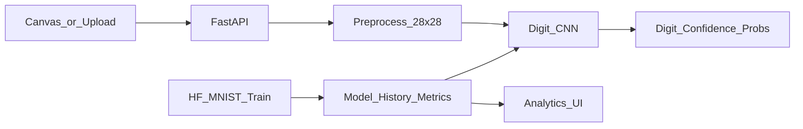

# Handwritten Digit Recognition System (MNIST via Hugging Face)

A production-quality educational project that trains a Convolutional Neural Network on the Hugging Face MNIST dataset (`ylecun/mnist`), serves predictions with FastAPI, and provides a React + Vite + TypeScript interface for drawing digits, uploading images, and exploring real training metrics.

## Architecture

```text
Frontend (React / Vite / Tailwind)
    │  draw / upload
    ▼
Backend (FastAPI / Uvicorn)
    │  preprocess → CNN inference
    ▼
ML artifacts (digit_cnn.keras, history.json, metrics.json)
    ▲
Training & evaluation (Hugging Face Datasets + TensorFlow/Keras)
```



## Requirements

- **Python 3.11** (recommended; TensorFlow does not support the system default 3.14)
- Node.js 20+ and npm
- ~2 GB free disk for dependencies and model artifacts
- Internet access for the first Hugging Face MNIST download

## Quick start

### 1. Create the Python environment

```powershell
cd "c:\Users\HARSH\OneDrive\Desktop\New folder\pyhton"
py -3.11 -m venv .venv
.\.venv\Scripts\Activate.ps1
python -m pip install --upgrade pip
pip install -r Backend\requirements.txt
```

### 2. Train the model (Hugging Face MNIST)

```powershell
python -m ML.training.train
```

This loads `ylecun/mnist`, trains the CNN with early stopping / checkpointing, and writes:

- `ML/artifacts/digit_cnn.keras`
- `ML/artifacts/history.json`

### 3. Evaluate on the test set

```powershell
python -m ML.evaluation.evaluate
```

Writes real metrics to `ML/artifacts/metrics.json` (accuracy, precision, recall, F1, confusion matrix).

### 4. Start the backend

```powershell
.\.venv\Scripts\Activate.ps1
uvicorn Backend.app.main:app --reload --host 127.0.0.1 --port 8000
```

- API docs: http://127.0.0.1:8000/docs
- Health: http://127.0.0.1:8000/api/health

### 5. Start the frontend

```powershell
cd Frontend
npm install
npm run dev
```

Open http://localhost:5173 — draw a digit and click **Predict**.

## Environment variables

Copy [`.env.example`](.env.example) to `.env` and optionally
[`Frontend/.env.example`](Frontend/.env.example) to `Frontend/.env`.

| Variable | Purpose |
|----------|---------|
| `MODEL_PATH` | Path to `.keras` model |
| `HISTORY_PATH` | Training history JSON |
| `METRICS_PATH` | Evaluation metrics JSON |
| `CORS_ORIGINS` | Allowed frontend origins |
| `MAX_UPLOAD_BYTES` | Upload size limit |
| `EPOCHS` / `BATCH_SIZE` / `LEARNING_RATE` / `RANDOM_SEED` | Training knobs |
| `VITE_API_BASE_URL` | Frontend API base (default `http://localhost:8000`) |

## API

| Method | Path | Description |
|--------|------|-------------|
| `GET` | `/api/health` | Service health and model availability |
| `POST` | `/api/predict` | Predict digit from `file` upload or `image_base64` form field |
| `GET` | `/api/model-info` | Architecture summary and evaluation snapshot |
| `GET` | `/api/metrics` | Training history + test metrics |

### Example prediction response

```json
{
  "predicted_digit": 7,
  "confidence": 0.97,
  "probabilities": {
    "0": 0.001,
    "1": 0.002,
    "2": 0.003,
    "3": 0.004,
    "4": 0.005,
    "5": 0.002,
    "6": 0.003,
    "7": 0.97,
    "8": 0.004,
    "9": 0.006
  }
}
```

Values above are illustrative; live responses use actual model outputs.

## Model

- Input: `28 × 28 × 1`, pixels normalized to `[0, 1]`
- Conv → ReLU → MaxPool → Conv → ReLU → MaxPool → Dropout → Dense → Softmax (10)
- Loss: sparse categorical cross-entropy · Optimizer: Adam
- Dataset: Hugging Face [`ylecun/mnist`](https://huggingface.co/datasets/ylecun/mnist)
- Random seed: `42` (configurable)

### Preprocessing

1. Convert to grayscale  
2. Detect white vs black background (mean intensity) and invert only when needed  
3. Crop digit bounding box, pad to square, resize to 28×28  
4. Normalize; reject empty / invalid / unsupported images  

## Project layout

```text
Backend/          FastAPI app, schemas, services
ML/
  preprocessing/  Shared inference preprocessing
  model/          CNN architecture
  training/       HF MNIST training script
  evaluation/     Test-set evaluation
  artifacts/      Saved model + metrics (regenerable)
Frontend/         React + Vite + TypeScript UI
Testing/          pytest suites
```

## Testing

### Backend / ML

```powershell
.\.venv\Scripts\Activate.ps1
pytest Testing -q
```

### Frontend

```powershell
cd Frontend
npm test
```

## Deployment notes

**Backend:** run with `uvicorn Backend.app.main:app --host 0.0.0.0 --port 8000` behind a reverse proxy. Set `CORS_ORIGINS` to your frontend URL. Ensure `MODEL_PATH` points to a trained artifact.

**Frontend:** `npm run build` then serve `Frontend/dist` with any static host. Set `VITE_API_BASE_URL` at build time.

## Troubleshooting

| Issue | Fix |
|-------|-----|
| TensorFlow install fails on Python 3.14 | Use `py -3.11 -m venv .venv` |
| `Model is not available` (503) | Run train + evaluate, then restart uvicorn |
| Empty canvas errors | Draw darker strokes; increase brush size |
| CORS errors | Add the frontend origin to `CORS_ORIGINS` |
| HF download slow / rate limited | Optional: set `HF_TOKEN` for higher limits |
| Poor accuracy on uploads | Prefer high-contrast single digits; avoid cluttered photos |

## Limitations

- Designed for single centered digits (0–9), not multi-digit or alphabetic characters.
- Real-world camera photos may need stronger preprocessing than MNIST-style drawings.
- CPU training is fine for MNIST but slower than GPU.

## License

Educational project — free to use and adapt for coursework.
